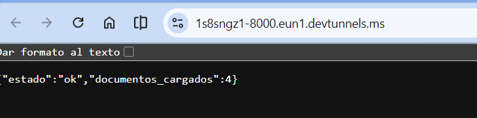
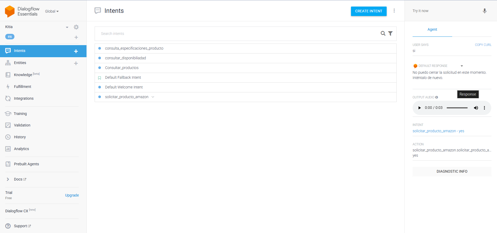
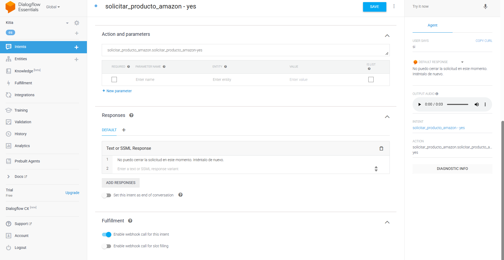
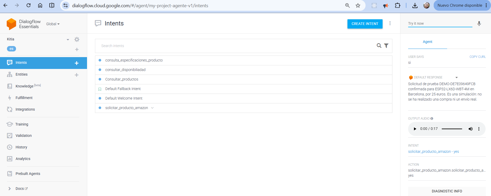
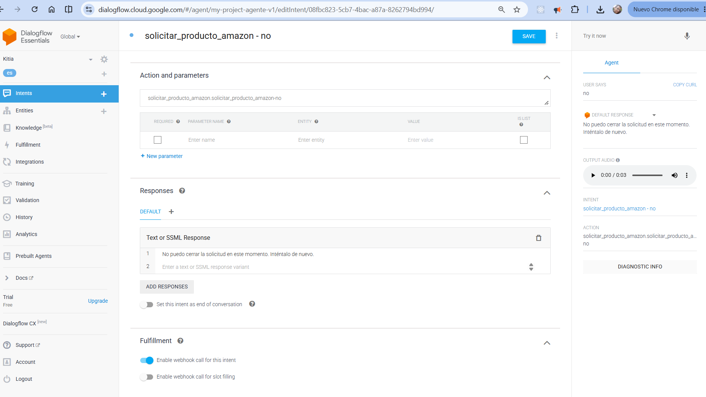
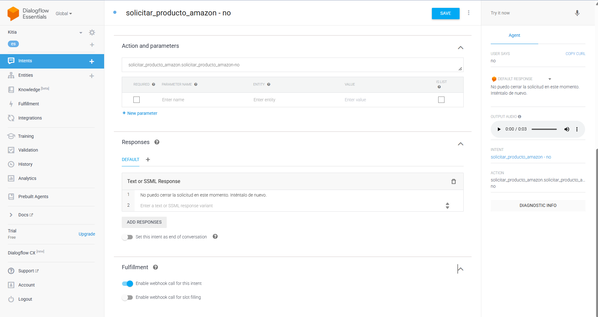
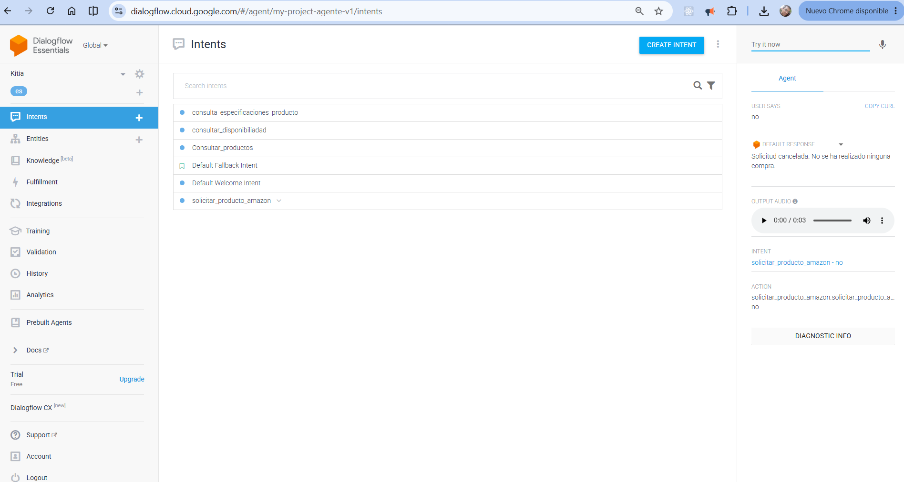
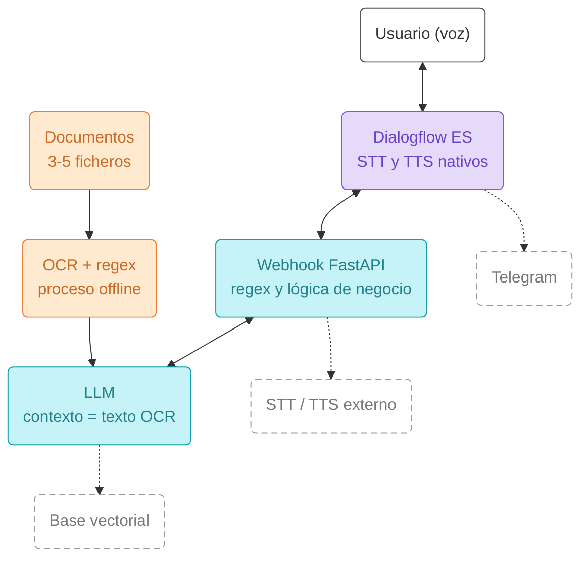
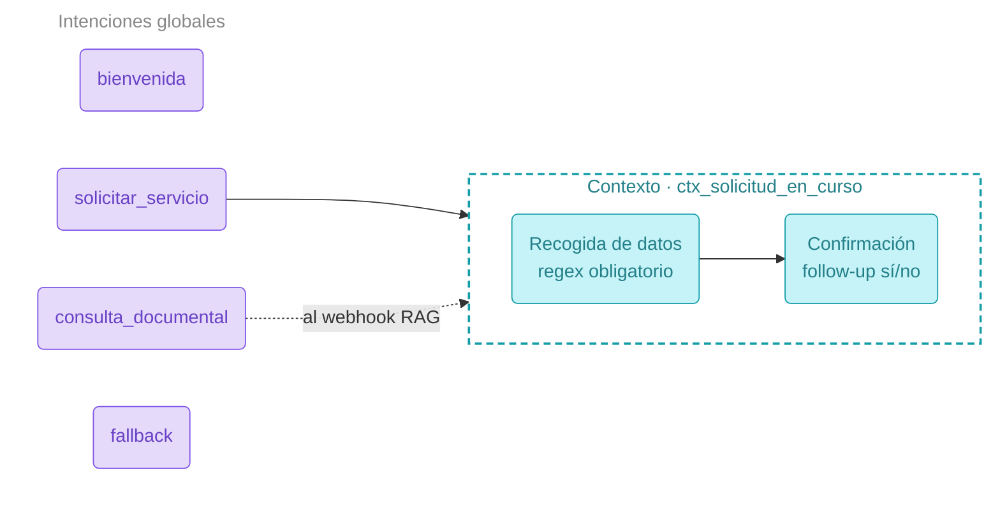

# Proyecto IA Clasica:

## Evidencia de acceso público al servidor

El 2 de noviembre de 2026, el usuario comprobó desde el navegador la dirección
`https://1s8sngz1-8000.eun1.devtunnels.ms/` y aportó la siguiente captura:



Respuesta observada:

```json
{"estado":"ok","documentos_cargados":4}
```

La evidencia confirma que el túnel público alcanzaba el servidor FastAPI y que
este informaba de cuatro documentos cargados en el momento de la captura.
Corresponde al endpoint de salud `GET /`; queda pendiente verificar las llamadas
`POST /webhook` desde Dialogflow, la estabilidad entre turnos y una latencia
inferior a cinco segundos por turno. La captura no mide esos tiempos ni acredita
por sí sola la calidad del OCR o las respuestas documentales del LLM.

### Prueba por texto: confirmación pendiente de resolver

En la siguiente prueba aportada por el usuario, Dialogflow identifica `si` como
`solicitar_producto_amazon - yes`, pero muestra el mensaje de respaldo:
«No puedo cerrar la solicitud en este momento. Inténtalo de nuevo».



El terminal muestra peticiones `POST /webhook` con estado HTTP 200. Sin embargo,
el último intercambio local consultado corresponde al turno anterior:
`solicitar_producto_amazon`, con SKU `ESP32-LX6D-WBT-4M`, ciudad `Barcelona` y
respuesta de preparación de la solicitud simulada `DEMO-0BC29B1D3559`.
Ese registro no contiene la confirmación final. Los estados HTTP 200 aportados
no identifican qué intención atiende cada petición ni acreditan por sí solos
que Dialogflow recibiera la respuesta dentro del plazo.

Este intento no completó el ciclo afirmativo; una prueba posterior satisfactoria
se recoge más abajo.

### Diagnóstico posterior: TIMEOUT_WEB confirmado

La nueva captura confirma que `Enable webhook call for this intent` está
activado en `solicitar_producto_amazon - yes`. El diagnóstico aportado por el
usuario identifica correctamente `si` con confianza de intención 1 y devuelve:

```json
{
  "diagnosticInfo": {"webhook_latency_ms": 4896},
  "webhookStatus": {
    "code": 4,
    "message": "Webhook call failed. Error: DEADLINE_EXCEEDED, State: URL_TIMEOUT, Reason: TIMEOUT_WEB."
  }
}
```



El fallo de ese turno es un timeout de la llamada al webhook; el mensaje de
respaldo no demuestra un problema de reconocimiento de «Sí». No se ha
determinado qué tramo de la conexión provoca la demora.

En una comprobación posterior, `GET /` respondió con HTTP 200 y cuatro documentos:
0,047 s por localhost y 1,012 s por el túnel público. Son dos medidas puntuales
del endpoint de salud, no tiempos de `POST /webhook` desde Dialogflow ni una
prueba de resolución del fallo intermitente.

Para la siguiente prueba se recomienda ejecutar el servidor sin recarga automática:

```powershell
.\.venv\Scripts\python.exe -m uvicorn main:app --port 8000
```

El terminal anterior muestra un reinicio provocado por un cambio de archivo y
una nueva ejecución de OCR. Omitir `--reload` evita esos reinicios durante la
demostración, aunque no se ha demostrado que causaran el timeout.

### Confirmación por texto completada

En la prueba posterior aportada por el usuario, `si` activa
`solicitar_producto_amazon - yes` y Dialogflow muestra:

> Solicitud de prueba DEMO-DE7E09649FCB confirmada para ESP32-LX6D-WBT-4M en Barcelona, por 25 euros. Es una simulación: no se ha realizado una compra ni un envío real.



El último intercambio local coincide con la captura: recibe la referencia
`DEMO-DE7E09649FCB` en estado `pendiente`, devuelve la confirmación y cierra el
contexto de solicitud con `lifespanCount: 0` y parámetros vacíos. La captura
muestra además audio de respuesta disponible.

Queda acreditado el cierre afirmativo por texto de esta solicitud. Esta evidencia
no mide la latencia, no demuestra que el fallo intermitente haya desaparecido y
no acredita la captura de voz del usuario. El siguiente paso es repetir el flujo
por texto terminando en `No`, comprobar la cancelación y después validar ambos
ciclos con el micrófono.

### Cancelación por texto: respuesta de respaldo

El siguiente intento aportado por el usuario reconoce `no` como
`solicitar_producto_amazon - no`. La captura muestra el webhook habilitado,
pero la respuesta es «No puedo cerrar la solicitud en este momento.
Inténtalo de nuevo» en lugar de la cancelación de negocio.



Al revisar el diagnóstico local después de esta captura, el último intercambio
seguía siendo la preparación de la solicitud `DEMO-361B933443E6`, para
`ESP32-LX6D-WBT-4M` en Barcelona, en estado `pendiente`. No se encontró el turno
de cancelación en ese último registro. Este archivo conserva solo el último
intercambio, por lo que no sustituye un historial completo de peticiones.

La cancelación de esta prueba no queda validada. El diagnóstico aportado después
por el usuario confirma `webhookStatus.code: 4`, `TIMEOUT_WEB` y
`webhook_latency_ms: 4897`. La petición conserva la referencia
`DEMO-361B933443E6` en estado `pendiente`, con SKU y ciudad correctos; la intención
`solicitar_producto_amazon - no` tiene confianza 1.



Para separar el procesamiento del servidor del acceso desde Dialogflow, se
ejecutó `docs/codetest/medir_cancelacion_webhook.py` con una sesión independiente,
referencia `DEMO-DIAGNOSTICO` y un contexto pendiente equivalente. La prueba no
envía ni cancela solicitudes en la sesión del usuario:

| Acceso directo a POST /webhook | HTTP | Tiempo | Respuesta |
| --- | --- | --- | --- |
| Localhost | 200 | 0,011 s | Solicitud cancelada. No se ha realizado ninguna compra. |
| Túnel público | 200 | 1,107 s | Solicitud cancelada. No se ha realizado ninguna compra. |

Ambas respuestas cierran el contexto con `lifespanCount: 0` y parámetros vacíos.
Los resultados se guardan en
`documentos/evidencias/cancelacion-mediciones.json`. Las llamadas directas no
reproducen el recorrido de Google a la URL pública: no validan todavía la
cancelación en Dialogflow ni garantizan la estabilidad o la latencia futura.
La comparación apunta a un fallo intermitente de comunicación, sin identificar
su causa exacta.

### Túnel alternativo preparado para comparar desde Dialogflow

Se descargó `cloudflared` portátil 2026.10.7 desde el enlace oficial de
[Cloudflare](https://developers.cloudflare.com/tunnel/downloads/) y se inició
un túnel temporal hacia `http://127.0.0.1:8000`, con transporte HTTP/2.
El ejecutable y los registros locales están en `docs/dialogflow/tools`, fuera
del seguimiento de Git. No se instaló un servicio del sistema.

URL preparada para Fulfillment en esta sesión:

```text
https://means-designated-isle-layer.trycloudflare.com/webhook
```

Dos llamadas directas de cancelación en una misma sesión de diagnóstico
independiente devolvieron HTTP 200, el mensaje de cancelación correcto y cierre
de contexto:

| URL pública | Tiempo de POST /webhook |
| --- | --- |
| VS Code devtunnels | 1,133 s |
| Cloudflare temporal | 0,220 s |

Resultado guardado en `documentos/evidencias/cancelacion-tunel-alternativo.json`.
Es una comparación puntual desde el PC; no acredita todavía la ruta desde Google
ni que haya desaparecido el fallo intermitente. El asistente no modificó la
configuración de Fulfillment; se indicó al usuario pegar la URL, guardar y
repetir el flujo terminando en `No`. El resultado posterior se recoge abajo.

El túnel queda activo en una sesión de terminal controlada por el asistente.
Para crear uno nuevo desde una terminal propia, manteniendo FastAPI encendido:

```powershell
.\.venv\Scripts\python.exe -m docs.dialogflow.iniciar_tunel
```

El lanzador muestra otra URL, que debe copiarse de nuevo a Fulfillment añadiendo
`/webhook`. Los [Quick Tunnels](https://developers.cloudflare.com/tunnel/get-started/quick-tunnels/)
son temporales y dependen de que el proceso siga abierto; no se presentan como
un despliegue definitivo para producción.

### Cancelación por texto completada

Tras la indicación de cambiar la URL de Fulfillment, el usuario aporta una
captura en la que `no` activa `solicitar_producto_amazon - no` y devuelve:

> Solicitud cancelada. No se ha realizado ninguna compra.



El último intercambio local coincide: recibe la referencia `DEMO-2D009FDEE74B`
en estado `pendiente`, con SKU `ESP32-LX6D-WBT-4M` y ciudad `Barcelona`, devuelve
el mensaje de cancelación y cierra el contexto con `lifespanCount: 0` y parámetros
vacíos. La captura muestra audio de respuesta disponible.

Queda acreditado el cierre negativo de esta solicitud por texto. La captura no
muestra la configuración de Fulfillment ni mide el tiempo del turno; no se usa
para garantizar la estabilidad del túnel ni acreditar reconocimiento de entrada
por micrófono. Ya hay evidencias de cierre afirmativo y negativo por texto; el
siguiente paso es repetir ambos ciclos con `cliente_voz.py`.

### Ciclos afirmativo y negativo completados con el micrófono

El usuario aporta el [registro completo de la prueba por voz](documentos/evidencias/ciclos-voz-confirmacion-cancelacion-2026-11-02.txt)
de la sesión `08c9a43e-0547-4aef-9745-bc43e89a4b56`, ejecutada con
`cliente_voz.py --segundos 8` y el micrófono predeterminado del sistema.

| Flujo | Reconocimiento y recuperación | Resultado |
| --- | --- | --- |
| Afirmativo | Inicio de solicitud; un dictado de SKU no se resuelve, se repite como «placa 1» y se normaliza a ESP32-LX6D-WBT-4M; «en la ciudad de Barcelona»; «sí confirmado». | Solicitud simulada DEMO-B56EAC27C1B1 confirmada por 25 euros. |
| Negativo | Nueva solicitud; dictado aproximado de SKU; propuesta confirmada con «sí es correcto»; Barcelona; una respuesta breve queda sin transcripción en ambos modelos; se repite como «no la confirmo». | Solicitud cancelada. No se ha realizado ninguna compra. |

Ambos ciclos alcanzan su cierre mediante entrada por micrófono en esta ejecución,
sin errores de webhook registrados. Se evidencia la recuperación mediante alias,
confirmación de propuesta y repetición de una respuesta no transcrita. No se
presenta como reconocimiento perfecto: el SKU literal y las respuestas breves
todavía pueden necesitar repetición.

El registro no mide el tiempo de procesamiento de cada turno ni verifica por sí
solo la audición de todas las respuestas TTS. Las duraciones de captura y recorte
no son mediciones de latencia del webhook. Siguen pendientes la validación de
latencia y las tareas documentales de OCR persistido, regex y respuesta del LLM.

# Objetivo

El objetivo es crear una herramientas usando (Dialogflow ES, expresiones regulares, OCR y servicios de voz) 
construyendo un asistente conversacional por voz que resuelva un caso de uso concreto.

# Descripcion del proyecto

Construir un agente conversacional para la empresa kit robotic, 
que se dedica a la venta de productos para armar drones de bajo coste. 
al que el usuario habla y que responde por voz.
El agente debe resolver un flujo de negocio con varios turnos y, además, ser capaz de responder preguntas
sobre un pequeño conjunto de documentos que habréis procesado previamente con OCR.

## Puesta en marcha

```bash
py -3.11 -m venv .venv
.venv\Scripts\activate          # Windows
python.exe -m pip install --upgrade pip
pip install -r requirements.txt
uvicorn main:app --reload --port 8000

# para la aplicacion de voz ejecute 
 python .\cliente_voz.py    
```


## Instalacion de Tesseract.

Son dos cosas: el programa y el paquete de Python.
esta aplicacion se instala desde: 
- https://github.com/UB-Mannheim/tesseract/wiki
- Windows: instalador de UB Mannheim, **marcando el paquete de idioma español** durante la instalación.
- Si el ejecutable no está en el `PATH`, `ocr.py` detecta automáticamente 
    la instalación en `C:\Program Files\Tesseract-OCR\tesseract.exe`. 
    Si está instalado en otra carpeta, ajustad `ejecutable_windows` al principio de `ocr.py`.
- Para usar también `tesseract --version` desde la terminal, 
    añadid `C:\Program Files\Tesseract-OCR` al `PATH` y abrid una terminal nueva. 
    El entorno virtual y `pip install pytesseract` no instalan el programa Tesseract.

Error típico: `Failed loading language 'spa'`. Significa que falta el `spa.traineddata`. Se arregla reinstalando con el idioma marcado, o bajando el fichero a la carpeta `tessdata`.

Probad el OCR solo, antes de meterlo en el webhook:


# Arquitectura de referencia para este proyecto

El siguiente esquema muestra el flujo completo que debe cubrir el prototipo. Las cajas con línea
discontinua son mejoras opcionales.




Línea discontinua = extra opcional para subir nota.

# Mapa de intenciones reducido

Mapa de intenciones mínimo esperado, con un único contexto activo.




