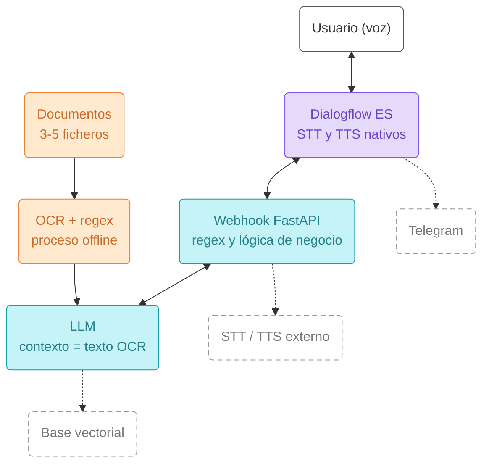
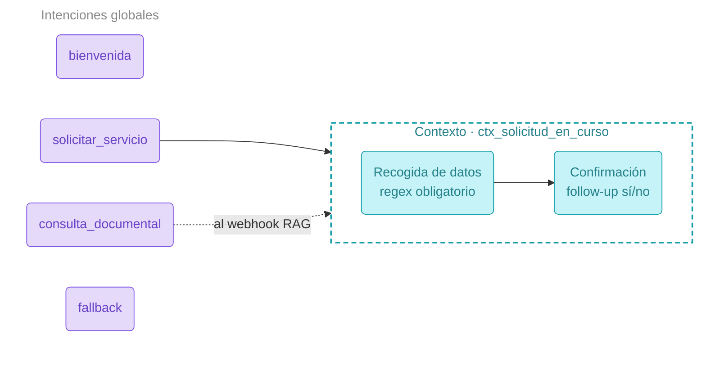

# Proyecto IA Clasica:

# Objetivo

El objetivo es crear una herramientas usando (Dialogflow ES, expresiones regulares, OCR y servicios de voz) 
construyendo un asistente conversacional por voz que resuelva un caso de uso concreto.

# Descripcion del proyecto

Construir un agente conversacional para la empresa kit robotic, 
que se dedica a la venta de productos para armar drones de bajo coste. 
al que el usuario habla y que responde por voz.
El agente debe resolver un flujo de negocio con varios turnos y, además, ser capaz de responder preguntas
sobre un pequeño conjunto de documentos que habréis procesado previamente con OCR.

## Puesta en marcha

```bash
py -3.11 -m venv .venv
.venv\Scripts\activate          # Windows
python.exe -m pip install --upgrade pip
pip install -r requirements.txt
uvicorn main:app --reload --port 8000

# para la aplicacion de voz ejecute 
 python .\cliente_voz.py    
```


## Instalacion de Tesseract.

Son dos cosas: el programa y el paquete de Python.
esta aplicacion se instala desde: 
- https://github.com/UB-Mannheim/tesseract/wiki
- Windows: instalador de UB Mannheim, **marcando el paquete de idioma español** durante la instalación.
- Si el ejecutable no está en el `PATH`, `ocr.py` detecta automáticamente 
    la instalación en `C:\Program Files\Tesseract-OCR\tesseract.exe`. 
    Si está instalado en otra carpeta, ajustad `ejecutable_windows` al principio de `ocr.py`.
- Para usar también `tesseract --version` desde la terminal, 
    añadid `C:\Program Files\Tesseract-OCR` al `PATH` y abrid una terminal nueva. 
    El entorno virtual y `pip install pytesseract` no instalan el programa Tesseract.

Error típico: `Failed loading language 'spa'`. Significa que falta el `spa.traineddata`. Se arregla reinstalando con el idioma marcado, o bajando el fichero a la carpeta `tessdata`.

Probad el OCR solo, antes de meterlo en el webhook:


# Arquitectura de referencia para este proyecto

El siguiente esquema muestra el flujo completo que debe cubrir el prototipo. Las cajas con línea
discontinua son mejoras opcionales.




Línea discontinua = extra opcional para subir nota.

# Mapa de intenciones reducido

Mapa de intenciones mínimo esperado, con un único contexto activo.




