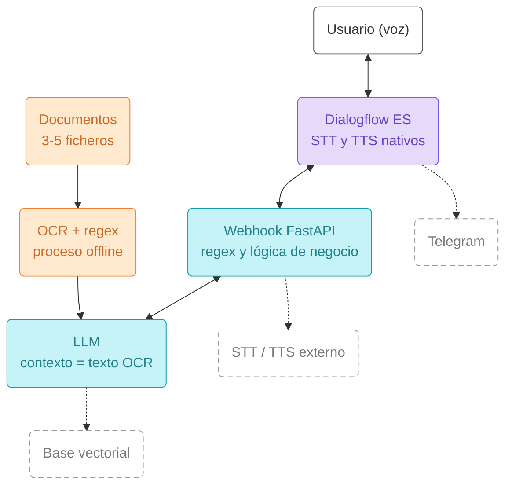
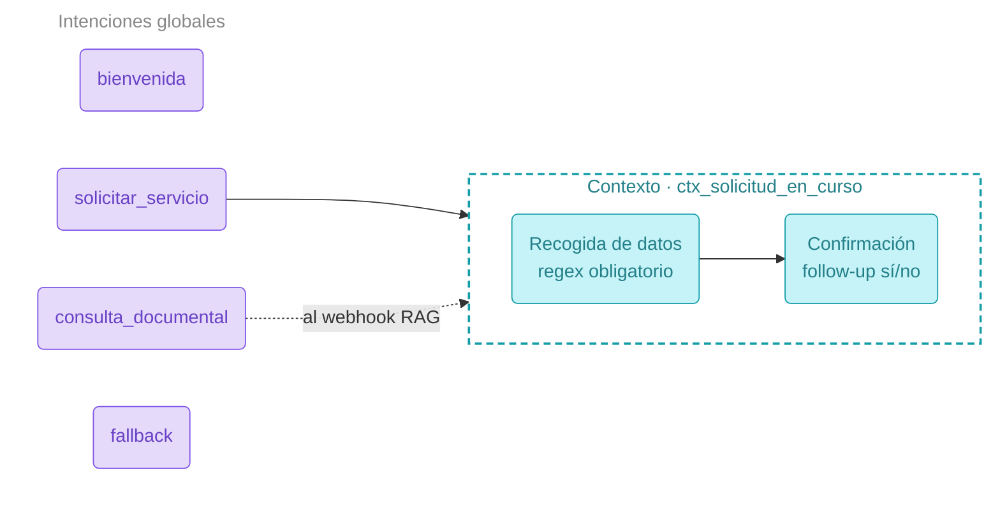

# Proyecto IA Clasica:
Trabajo en la materia de Herramientas de IA Clasica
Alumno: German Dario Realpe zambrano
Pontia:

## Evidencias de funcionamiento

Las siguientes evidencias recogen ejecuciones satisfactorias del prototipo.
Las solicitudes son simuladas: no se realizan compras ni envíos reales.

video de youtube https://youtu.be/P5S07cUQtYQ


### Acceso público y documentos cargados

La comprobación del 2 de noviembre de 2026 muestra acceso público al servidor
FastAPI y cuatro documentos cargados:

```json
{"estado":"ok","documentos_cargados":4}
```


Esta captura corresponde al endpoint de salud `GET /` del túnel utilizado en
esa comprobación.

### Confirmación por texto

En Dialogflow, `si` activa `solicitar_producto_amazon - yes` y devuelve:

> Solicitud de prueba DEMO-DE7E09649FCB confirmada para ESP32-LX6D-WBT-4M en Barcelona, por 25 euros. Es una simulación: no se ha realizado una compra ni un envío real.


El intercambio local revisado confirma el cierre del contexto de solicitud
con `lifespanCount: 0` y parámetros vacíos.

### Cancelación por texto

En Dialogflow, `no` activa `solicitar_producto_amazon - no` y devuelve:

> Solicitud cancelada. No se ha realizado ninguna compra.


El intercambio local revisado corresponde a la referencia `DEMO-2D009FDEE74B`,
con el SKU esperado y Barcelona; acredita la cancelación y el cierre del contexto.

### Confirmación y cancelación por voz

El [registro completo de la prueba por voz](documentos/evidencias/ciclos-voz-confirmacion-cancelacion-2026-11-02.txt)
corresponde a la sesión `08c9a43e-0547-4aef-9745-bc43e89a4b56`, ejecutada con
`cliente_voz.py --segundos 8` y el micrófono predeterminado del sistema.

| Ciclo | Datos | Resultado |
| --- | --- | --- |
| Afirmativo | ESP32-LX6D-WBT-4M, Barcelona, «sí confirmado». | Solicitud simulada DEMO-B56EAC27C1B1 confirmada por 25 euros. |
| Negativo | ESP32-LX6D-WBT-4M, Barcelona, «no la confirmo». | Solicitud cancelada. No se ha realizado ninguna compra. |

Ambos ciclos se completan mediante entrada de micrófono. El registro original
se conserva íntegro e incluye la recuperación mediante alias, confirmación de
propuesta y repetición de una respuesta. Esta evidencia no implica reconocimiento
perfecto ni constituye una medición de latencia por turno.

### Mediciones directas del webhook

Las pruebas de cancelación simulada mediante `POST /webhook` devolvieron HTTP 200,
el mensaje de cancelación y el cierre del contexto:

| Comprobación | Localhost | Túnel de VS Code | Túnel temporal de Cloudflare |
| --- | --- | --- | --- |
| Primera medición | 0,011 s | 1,107 s | — |
| Comparación de túneles | — | 1,133 s | 0,220 s |

Resultados: [medición local y pública](documentos/evidencias/cancelacion-mediciones.json)
y [comparación de túneles](documentos/evidencias/cancelacion-tunel-alternativo.json).
Son llamadas directas desde el PC con una sesión de diagnóstico independiente;
no miden el turno completo desde Dialogflow ni garantizan tiempos futuros.

## Túnel público para ejecutar la demostración

Mantén FastAPI encendido sin recarga automática:

```powershell
.\.venv\Scripts\python.exe -m uvicorn main:app --port 8000
```

En otra terminal, inicia el túnel:

```powershell
.\.venv\Scripts\python.exe -m docs.dialogflow.iniciar_tunel
```

El lanzador requiere `docs/dialogflow/tools/cloudflared.exe`, disponible en las
[descargas oficiales de Cloudflare](https://developers.cloudflare.com/tunnel/downloads/).
Copia la URL HTTPS anunciada, añade `/webhook` y guárdala en Fulfillment de
Dialogflow. Mantén ambas terminales abiertas durante la demostración.
Los [Quick Tunnels](https://developers.cloudflare.com/tunnel/get-started/quick-tunnels/)
son temporales: al crear otro túnel hay que actualizar la URL en Dialogflow.

# Objetivo

El objetivo es crear una herramientas usando (Dialogflow ES, expresiones regulares, OCR y servicios de voz) 
construyendo un asistente conversacional por voz que resuelva un caso de uso concreto.

# Descripcion del proyecto

Construir un agente conversacional para la empresa kit robotic, 
que se dedica a la venta de productos para armar drones de bajo coste. 
al que el usuario habla y que responde por voz.
El agente debe resolver un flujo de negocio con varios turnos y, además, ser capaz de responder preguntas
sobre un pequeño conjunto de documentos que habréis procesado previamente con OCR.

## Puesta en marcha

```bash
py -3.11 -m venv .venv
.venv\Scripts\activate          # Windows
python.exe -m pip install --upgrade pip
pip install -r requirements.txt

# Una vez antes del primer arranque, o al cambiar las imágenes:
python ocr.py

uvicorn main:app --port 8000

# para la aplicacion de voz ejecute 
 python .\cliente_voz.py    
```


## Instalacion de Tesseract.

Son dos cosas: el programa y el paquete de Python.
esta aplicacion se instala desde: 
- https://github.com/UB-Mannheim/tesseract/wiki
- Windows: instalador de UB Mannheim, **marcando el paquete de idioma español** durante la instalación.
- Si el ejecutable no está en el `PATH`, `ocr.py` detecta automáticamente 
    la instalación en `C:\Program Files\Tesseract-OCR\tesseract.exe`. 
    Si está instalado en otra carpeta, ajustad `ejecutable_windows` al principio de `ocr.py`.
- Para usar también `tesseract --version` desde la terminal, 
    añadid `C:\Program Files\Tesseract-OCR` al `PATH` y abrid una terminal nueva. 
    El entorno virtual y `pip install pytesseract` no instalan el programa Tesseract.

Error típico: `Failed loading language 'spa'`. Significa que falta el `spa.traineddata`. Se arregla reinstalando con el idioma marcado, o bajando el fichero a la carpeta `tessdata`.

## OCR offline, archivo persistido y validación con regex

El OCR se ejecuta por separado del servidor:

```powershell
.\.venv\Scripts\python.exe .\ocr.py
```

Procesa las cuatro imágenes del nivel inmediato de `documentos` y guarda
[documentos/texto_ocr.json](documentos/texto_ocr.json). Las capturas de
`documentos/evidencias` no se incorporan al corpus.

El JSON contiene el texto original reconocido, campos extraídos con expresiones
regulares y el SHA-256 de cada imagen de origen. También registra motor,
idioma y configuración (`Tesseract`, `spa`, `--psm 6`). No se aplican sustituciones
destructivas al texto que se envía al modelo de lenguaje.

Resultado de la extracción real del 2 de noviembre de 2026:

| Imagen | Caracteres OCR | SKU completos | Importes | Fechas |
| --- | --- | --- | --- | --- |
| 01_catalogo_esp32_clasicos.png | 544 | 3 | 3 | 1 |
| 02_catalogo_esp32_s3.png | 458 | 2 | 2 | 1 |
| 03_catalogo_esp32_c.png | 589 | 4 | 4 | 1 |
| 04_catalogo_esp32_h2_p4.png | 473 | 2 | 2 | 1 |

Se extraen 11 referencias diferentes, 11 importes y cuatro apariciones de la
fecha `02/11/2026`. Por ejemplo, la regex conserva `ESP32-LX6D-WBT-4M` completo,
en lugar de truncarlo a los tres primeros grupos. Es validación de formato y
extracción de campos; no garantiza por sí sola que cualquier OCR sea correcto.

`main.py` carga el corpus mediante `documentacion_ocr.py` sin ejecutar Tesseract,
y utiliza sus textos en la selección documental y en el contexto del LLM.
Si el JSON falta, está corrupto o contiene documentos sin texto, el arranque
falla con un mensaje explicativo. No hay OCR automático de respaldo. Si la
generación falla en alguna imagen, no se sobrescribe el corpus anterior con un
resultado parcial. Tras cambiar imágenes, vuelve a ejecutar `ocr.py` y reinicia
FastAPI para cargar la nueva versión.

El archivo generado se incluye expresamente en Git para la entrega. Tesseract
solo es necesario para regenerarlo, no para cargar el corpus al arrancar.

Verificación realizada: generación real con los cuatro documentos y cuatro
pruebas locales de `docs/codetest/test_corpus_ocr.py`. Comprueban SKU completos,
rechazo de corpus ausente o corrupto sin OCR automático, conservación del corpus
previo ante una extracción incompleta, y arranque con el corpus real sin OCR.
La integración comprueba el contexto enviado al modelo con una respuesta
simulada y la negativa a una consulta sin coincidencias documentales.
Una prueba de renombrado temporal quedó bloqueada por el sandbox de Windows
y pasó al repetirla con autorización fuera de ese entorno.
No se ha consultado Gemini en esta etapa. Por indicación del usuario se omite
la prueba real de respuesta documental; este aspecto no se da por validado.

## SSML para las respuestas habladas

`docs/dialogflow/respuestas_voz.py` genera SSML en las respuestas dinámicas del
webhook. `fulfillmentText` conserva el texto legible y
`fulfillmentMessages[0].text.text[0]` contiene la versión para síntesis de voz.
Se utiliza el formato de [respuestas de texto o SSML de Dialogflow ES](https://docs.cloud.google.com/dialogflow/es/docs/intents-rich-messages#text_responses).

Ejemplo:

```xml
<speak>El producto <say-as interpret-as="characters">ESP32-LX6D-WBT-4M</say-as> está disponible. <break time="180ms"/>¿Confirmas?</speak>
```

El marcado permite lectura por caracteres de los SKU y pausas de 180 ms antes
de las preguntas. El texto dinámico se escapa como XML para que caracteres como
`&` o `<` no se interpreten como etiquetas. Las etiquetas empleadas están
descritas en la [referencia SSML de Google](https://docs.cloud.google.com/text-to-speech/docs/ssml).

`main.py` aplica el marcado a las respuestas de negocio, ayuda de SKU, consultas
documentales y mensajes de error. Las respuestas vacías de recogida de parámetros
y escucha de confirmaciones siguen vacías. Se conservan los contextos y los
payloads. El diagnóstico local incluye `mensajes_devueltos` para inspeccionar el
SSML emitido. Las preguntas de parámetros y la bienvenida configuradas directamente
en el agente no se modifican en esta etapa.

Para cargar el cambio, reinicia FastAPI. No es necesario reimportar el agente
ni cambiar la URL de Fulfillment:

```powershell
.\.venv\Scripts\python.exe -m uvicorn main:app --port 8000
```

Cinco pruebas locales de `docs/codetest/test_respuestas_ssml.py` pasan:
escape XML y lectura de SKU, respuestas vacías, preparación y cierre sí/no,
ayuda/documentación y catálogo/errores. Se valida además el JSON con el esquema
`WebhookResponse` del SDK de Dialogflow ES y que el texto del XML coincida con
el mensaje visible. La ejecución inicial en el sandbox se bloqueó en la parte
asíncrona y se detuvo; las cinco pruebas pasaron fuera del sandbox con autorización.
No hubo consultas a Gemini ni a Dialogflow. No se acredita todavía mediante
estas pruebas la síntesis real, su calidad auditiva ni una latencia inferior a
cinco segundos por turno.


# Arquitectura de referencia para este proyecto

El siguiente esquema muestra el flujo completo que debe cubrir el prototipo. Las cajas con línea
discontinua son mejoras opcionales.




Línea discontinua = extra opcional para subir nota.

# Mapa de intenciones reducido

Mapa de intenciones mínimo esperado, con un único contexto activo.




