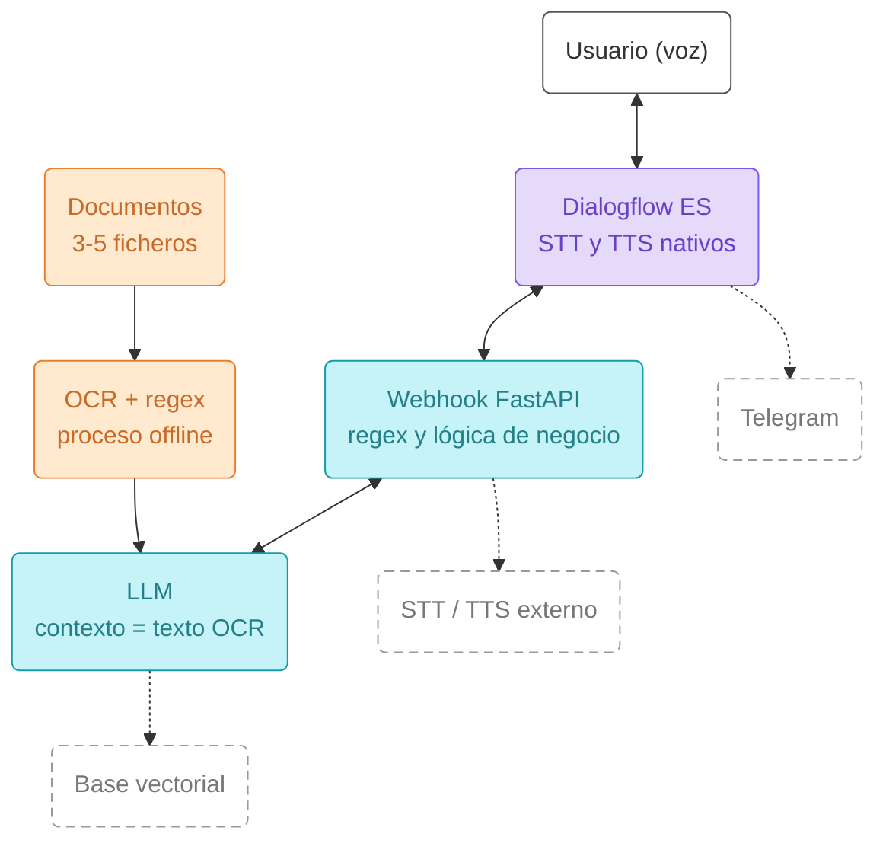
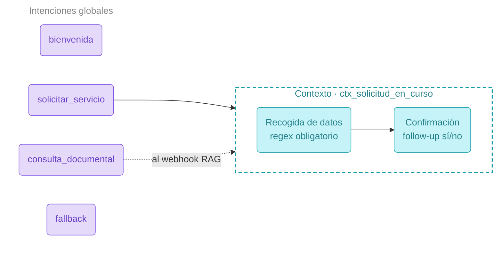

# Proyecto IA Clasica:

# Objetivo

El objetivo es crear una herramientas usando (Dialogflow ES, expresiones regulares, OCR y servicios de voz) 
construyendo un asistente conversacional por voz que resuelva un caso de uso concreto.

# Descripcion del proyecto

Construir un agente conversacional para la empresa kit robotic, 
que se dedica a la venta de productos para armar drones de bajo coste. 
al que el usuario habla y que responde por voz.
El agente debe resolver un flujo de negocio con varios turnos y, además, ser capaz de responder preguntas
sobre un pequeño conjunto de documentos que habréis procesado previamente con OCR.

## Puesta en marcha

```bash
py -3.11 -m venv .venv
.venv\Scripts\activate          # Windows
python.exe -m pip install --upgrade pip
pip install -r requirements.txt
uvicorn main:app --reload --port 8000

# para la aplicacion de voz ejecute 
 python .\cliente_voz.py    
```


# Requisitos obligatorios

1. Agente conversacional en Dialogflow ES

- Entre 6 intenciones significativas para este caso de uso, además de la de bienvenida y la de fallback.

- Entidades: al menos una entidad regex (por ejemplo codigo SKU, teléfono, NIF, código de pedido) y alguna entidad de sistema o personalizada.

- Gestión de contexto: un único flujo multi-turno gestionado con contexto, que recoja
parámetros obligatorios y termine con una intención de seguimiento de confirmación (sí/no).
No es obligatorio implementar la corrección de datos a mitad de flujo ni el salto entre contextos, que
se ve en clase. Si lo hacéis, cuenta como extra.

2. Voz

- La conversación debe funcionar de extremo a extremo por voz: el usuario habla y el agente
responde hablando.

- Es válido utilizar el STT y el TTS nativos de Dialogflow mediante el modo audio. Integrar servicios externos es opcional.

- se debe cuidad la naturalidad de la voz con etiquetas SSML y mantened una latencia razonable (por debajo de 5 segundos por turno).

3. Webhook con logica de negocio

- debe teber Un webhook en FastAPI, expuesto a internet, que reciba la petición de Dialogflow y devuelva una respuesta dinámica.

- Debe validar al menos un parámetro con una expresión regular y generar una respuesta que dependa de los datos recogidos.

4. OCR y respuesta documental

· Extracción: Procesad entre 4 documentos con una herramienta de OCR (Tesseract, Azure
Document Intelligence o un modelo VLM vía Ollama). Es un proceso offline que se ejecuta una
sola vez.

· Validación: Aplicad alguna expresión regular sobre el texto extraído para validar o extraer un
campo (fechas, importes, códigos, referencias).
· Consulta: El texto resultante se guarda en un fichero (texto plano o JSON) y el webhook lo envía
como contexto a un LLM para responder preguntas sobre esos documentos.

· Control de alucinaciones: Si la pregunta no se puede responder con los documentos, el sistema
debe decirlo explícitamente en lugar de inventarse la respuesta.

# Arquitectura de referencia para este proyecto

El siguiente esquema muestra el flujo completo que debe cubrir el prototipo. Las cajas con línea
discontinua son mejoras opcionales.
en esta version no se implementa telegram.



Línea discontinua = extra opcional para subir nota.

# Mapa de intenciones reducido

Mapa de intenciones mínimo esperado, con un único contexto activo.



Un solo contexto obligatorio · corregir datos pasa a extra.


# Mejoras opcionales no se implentaran en esta version.


· Integración con Telegram o Slack, especialmente si usáis respuestas enriquecidas (tarjetas,botones, imágenes).

· STT o TTS de terceros (Whisper, Azure Speech, ElevenLabs). La clonación de voz propia para el bot se valorará especialmente.

· Gestión de interrupciones y corrección de datos a mitad de flujo mediante eventos.

· Base de datos vectorial (ChromaDB, FAISS) en lugar de contexto directo en el prompt.

· Documentos de entrada complejos: manuscritos, tablas, gráficos o formularios escaneados.

· Intención adicional de transferencia a agente humano.


# Resultado final 


1. Repositorio o fichero comprimido con el export del agente de Dialogflow, el script
de OCR y el código del webhook.

2. Fichero README.md que incluya: descripción del caso de uso en un párrafo, diagrama de la
arquitectura, lista de intenciones con su proposito, 
decisiones tecnicas tomadas e instrucciones 
para ejecutar el proyecto. 
3. El diagrama puede ser una captura de Excalidraw, draw.io o incluso
una foto de un boceto a mano.

# Criterios de evaluacion

1. Agente Dialogflow: intenciones, entidad regex, contexto y confirmación

2. Voz: conversación completa por STT y TTS

3. OCR, validación con regex y respuesta documental sin alucinar.

4. Documentación, diagrama 